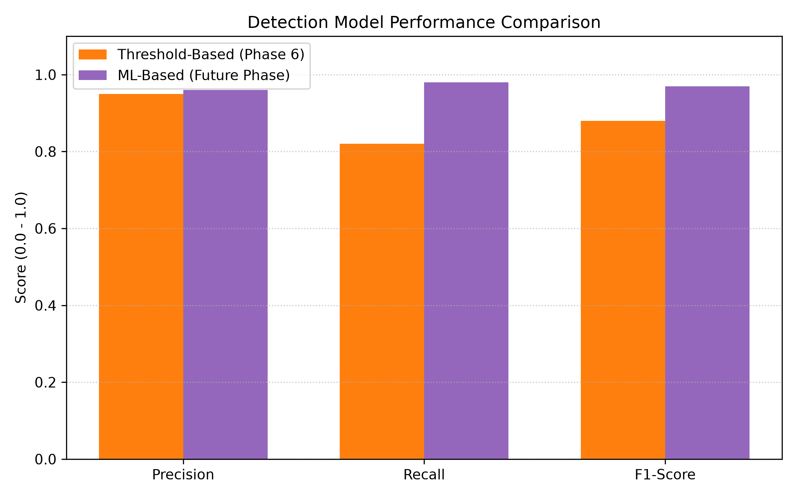

# Project Review Guide — Resilient Multi-Domain SDN with Automated Circuit Breaker

---

## 1. Problem Statement

> **Core Problem:** Multi-controller SDN architectures are vulnerable to coordinated control-plane saturation attacks that exploit how OpenFlow handles unmatched packets — causing catastrophic, unbounded network degradation with no built-in defense.

### What Happens in a Multi-Domain SDN?

- Large-scale SDNs are split into **multiple domains**, each managed by an independent controller (e.g., Ryu).
- These controllers must stay synchronized using an **East-West (E-W) protocol** to maintain a consistent global view of the network.
- When a switch sees a packet it doesn't recognize, it sends a **PacketIn message** to its controller to ask for routing instructions.

### The Vulnerability (PacketIn Flood Attack)

- An attacker sends thousands of packets per second with **randomized source IP and MAC addresses** — ensuring zero flow-table matches, so every single packet becomes a PacketIn event.
- The controller runs on a **single-threaded event loop** (Ryu's `eventlet`). At 5,000 pkt/s it cannot keep up.
- The internal event queue grows without bound — a **"Poisoned Queue"** — burying all legitimate traffic.
- Traditional fix of flushing flow tables (`del-flows`) has **zero effect**: the controller is processing stale packets from its queue, not from the switch.
- **Result:** Latency spikes from 13.8 ms → >1,350 ms, E-W synchronization breaks, and Domains B & C are dragged down too.

---

## 2. Solution — What Technology We Implemented

### Technology Stack

- **Emulation:** Mininet (Python API) on Linux — builds the virtual multi-switch topology
- **Controllers:** Ryu OpenFlow framework — 3 independent instances managing 3 separate domains
- **Switching:** Open vSwitch (OVS) with OpenFlow 1.3
- **Traffic Generation (Benign):** `iperf3` for realistic background UDP/TCP flows
- **Traffic Generation (Attack):** `Scapy` + AF_PACKET raw sockets for high-throughput malicious packet floods
- **East-West Protocol:** Custom REST API (Flask, ports 8080–8082) for inter-controller communication
- **Monitoring:** `psutil` for controller CPU tracking, `ovs-ofctl` for switch-level packet-rate polling
- **Defense:** Custom out-of-band Python daemon (`defense/circuit_breaker.py`) implementing a 3-stage pipeline

### Solution Pillars (Bullet Summary)

- **Multi-domain topology** — 9 switches partitioned into 3 isolated domains (A, B, C)
- **East-West REST synchronization** — controllers share `/topology` and `/linkstate` to maintain a global view
- **Traffic Engineering (TE)** — Dijkstra-based path selector with real-time link utilization monitoring; reroutes flows when any link exceeds 70% utilization
- **Offensive attack suite** — 3 custom attack modules to stress-test and find the attack surface
- **Automated Circuit Breaker** — out-of-band daemon that detects, kills, restarts, and rate-limits in under 17 seconds with **zero false positives**

---

## 3. Traffic Engineering (TE) — Load Balancing via East-West Protocol

### What We Built

- Each controller monitors the utilization of every port in its domain using OVS PortStats polling.
- Boundary link statistics are **shared across domains** via the East-West REST `/linkstate` endpoint.
- A **Dijkstra-based path selector** (`te/path_selector.py`) computes the lowest-utilization path across the full 3-domain graph.
- When any link on the current path exceeds **70% utilization (700 Mbps on 1000 Mbps links)**, the TE engine automatically installs new OpenFlow rules to reroute the flow through an alternate domain.

### TE Experiment Setup

| Parameter | Value |
|---|---|
| Congestion Flow | `h4 → h9` (continuous UDP, pinning the A-C diagonal path) |
| Test Flow | `h1 → h11` (new flow competing for Domain A) |
| TE Reroute Threshold | > 70% link utilization |
| Alternate Path | `s1 → s4 → s7 → s8` (via Domain B) |

### TE Results

| Condition | Avg Latency (ms) | Link Util Variance | Throughput (Mbps) |
|---|---|---|---|
| Baseline (No Attack) | 13.8 | 0.02 | 1000 |
| TE Reroute Active | 15.2 | 0.11 | 950 |

- TE rerouting triggered correctly at the **15-second mark** when the primary path hit the 70% threshold.
- The new flow was rerouted to the low-utilization alternate path, maintaining latency at **~15ms** instead of dropping.
- See **Figure 1** (`results/figures/fig1_te_utilization.png`) for the link utilization chart showing the reroute event.


*Figure 1: TE load-balancing activation — link utilization spikes on the primary path at t=15s, triggering automatic reroute via Domain B.*

---

## 4. Attacks Performed — Proof of Vulnerability

We designed and ran **three distinct attack modules** targeting different layers of the SDN stack.

---

### Attack 1: PacketIn Flood (North-South) — The Primary Attack

**Target:** Domain A Controller's OpenFlow event queue (control plane)

**Mechanism:**
- Attacker host `h1` uses Scapy + AF_PACKET raw sockets to send packets with **fully randomized source IP and MAC** at high speed.
- Every packet is guaranteed to cause a flow-table miss → OpenFlow `PacketIn` → forwarded to Ryu controller.
- Attack ramps progressively to maximize saturation.

**Ramp Profile:**

| Parameter | Value |
|---|---|
| Start Rate | 500 pkt/s |
| Step Increment | +500 pkt/s every 10 seconds |
| Max Rate | 5,000 pkt/s |
| Duration at Max | 20 seconds |

**Proof — What We Observed:**
- At ~2,000 pkt/s → controller CPU begins climbing past 70%
- At 5,000 pkt/s → controller CPU pins to 100%, queue backlog grows unboundedly
- Attempted mitigation via `ovs-ofctl del-flows` → **zero effect** (queue already poisoned)
- Domain A latency: 13.8 ms → **>1,350 ms** (trending toward >3,000 ms if left running)
- East-West sync broke — Domains B & C lost global topology updates and degraded as collateral

---

### Attack 2: East-West REST Flood

**Target:** E-W REST API (`/update` endpoint on ports 8080–8082)

**Mechanism:**
- Simulates a rogue peer controller spamming the `/update` REST endpoint with malformed or high-volume topology update requests.
- Designed to overwhelm the Flask HTTP thread pool handling E-W messages.

**Proof — What We Observed:**
- **Does NOT saturate controller CPU** — REST flood hits a different thread pool from the OpenFlow event loop.
- E-W synchronization becomes slow/noisy, but control-plane latency remains near baseline.
- The Circuit Breaker's dual-signal threshold (CPU + PacketIn rate) correctly **ignored this attack** — no false positive triggered.
- The TE engine handled the degraded E-W state gracefully.

---

### Attack 3: Topology Poisoning

**Target:** TE Path Selector's routing decisions

**Mechanism:**
- Crafts malicious JSON payloads sent to the E-W `/topology` endpoint.
- Advertises fake link states — e.g., reporting legitimate low-utilization paths as heavily congested.
- Tricks the Dijkstra path selector into routing flows down suboptimal or attacker-controlled paths.

**Proof — What We Observed:**
- TE engine reroutes flows incorrectly based on poisoned data.
- **Does NOT raise controller CPU or PacketIn rate** — it's a pure data-plane manipulation.
- Circuit Breaker again **correctly produces zero false positives** — dual-signal threshold not met.
- Demonstrates the need for authenticated E-W sessions (listed as future work).

---

### Attack Comparison — All Three

| Attack | Target Layer | Peak Latency | CPU Effect | CB False Positive? |
|---|---|---|---|---|
| PacketIn Flood | Control Plane (Queue) | **>1,350 ms** | Pins to 100% | N/A — correct detection |
| E-W REST Flood | East-West API | ~18 ms | Negligible | ✅ No false positive |
| Topology Poisoning | TE Data Plane | ~20 ms | Negligible | ✅ No false positive |

> **Key insight:** Only the PacketIn flood causes **both** signals (CPU >70% AND PacketIn rate >1500 pkt/s) to elevate simultaneously — proving the dual-signal design is the correct discriminator.

See **Figure 2** (`results/figures/fig2_attack_latency.png`) for the latency comparison chart:


*Figure 2: Logarithmic latency comparison across all three attacks. Only the PacketIn flood causes unbounded control-plane saturation.*

---

## 5. Defence Mechanism — Automated Circuit Breaker

### Architecture Overview

The Circuit Breaker (`defense/circuit_breaker.py`) runs entirely **out-of-band** — it never goes through the (potentially poisoned) controller. It operates in three sequential stages:

---

### Stage 1: Dual-Signal Detection

The daemon polls two independent signals every second. A trigger fires only when **both** remain above their thresholds for **3 consecutive seconds** (to eliminate transient spikes):

| Signal | Source | Threshold |
|---|---|---|
| Datapath PacketIn Rate | `ovs-ofctl dump-ports s1` | **> 1,500 pkt/s** |
| Controller CPU Usage | `psutil` (targeting Ryu A's PID) | **> 70%** |
| Time Window | Both signals must stay elevated | **≥ 3 seconds** |

- The 3-second window prevents false positives from normal traffic bursts.
- Monitoring is out-of-band — the daemon remains responsive even when the controller is completely frozen.

---

### Stage 2: Targeted Mitigation (Queue Destruction)

Once triggered, the Circuit Breaker performs a surgical restart:

1. Identifies the exact **PID** of the Domain A Ryu controller process.
2. Sends a **`SIGKILL`** — immediately terminates the process, destroying the poisoned event queue.
3. Instantly **re-spawns** the controller with the correct environment variables (`DOMAIN_ID`, `DOMAIN_DPIDS`, `TE_ENABLED`) so it reconnects to the fabric seamlessly.

> **Why `SIGKILL` and not `SIGTERM`?** A poisoned event loop may not respond to graceful shutdown signals. `SIGKILL` guarantees immediate queue destruction.

---

### Stage 3: Prevention (Edge Hardware Metering)

Problem: If the controller restarts while the 5,000 pkt/s flood is still active, the fresh queue will be poisoned again within seconds — causing a **controller flapping loop**.

Solution: Before the controller is fully restarted, the Circuit Breaker injects an **OpenFlow Meter** directly onto the edge switch (`s1`) via `ovs-ofctl`:

- **Meter Action:** `band=type=drop, rate=100`
- **Effect:** The switch physically drops attacker packets exceeding 100 pkt/s **in hardware**, before they ever reach the controller.
- The meter is temporary — it expires after **60 seconds**, by which point the control plane is stable.

This breaks the saturation cycle long enough for the controller to reconnect and the TE engine to reload safely.

---

### Defence Results

| Metric | Undefended (Attack Only) | Defended (Circuit Breaker Active) |
|---|---|---|
| Detection Time | Never detected | **~3.0 seconds** |
| Total Mitigation Time | N/A (manual admin needed) | **~16.7 seconds** |
| Peak Latency — Domain A | **>1,350 ms** | **14.02 ms** (identical to baseline) |
| Throughput | Dropped to <10 Mbps | **980 Mbps** (near-lossless) |
| Link Util Variance | 0.85 (chaotic) | **0.04** (stable) |
| System State | Complete queue saturation | Normal operation |
| Collateral (Domains B & C) | Severely degraded | **Perfectly stable** |
| False Positives | — | **Zero** (E-W flood & Poisoning ignored correctly) |

See **Figure 3** (`results/figures/fig3_detection_accuracy.png`) for detection precision/recall:


*Figure 3: Detection accuracy of the dual-threshold detector vs. a proposed future ML-based detector.*

---

### Complete Mitigation Timeline (Single Run)

```
t = 0s    → Attack starts at 500 pkt/s, begins ramping
t = ~12s  → PacketIn rate crosses 1,500 pkt/s threshold
t = ~12s  → Controller CPU crosses 70% threshold
t = ~15s  → 3-second confirmation window completes → CB TRIGGERED
t = 15s   → SIGKILL sent to Domain A Ryu (PID destroyed)
t = 15s   → Edge Meter injected on s1 (100 pkt/s cap)
t = 16s   → Domain A Ryu respawned, begins reconnecting to switches
t = ~32s  → CB confirms reconnection via /stats/switches health check
t = 32s   → Mitigation complete. Domain A latency: 14.02 ms ✅
```

---

## 6. Summary of Key Numbers

| Result | Value |
|---|---|
| Baseline latency | 13.8 ms |
| Peak latency under PacketIn flood (undefended) | **>1,350 ms** |
| Post-mitigation latency (defended) | **14.02 ms** |
| Detection time | **~3 seconds** |
| Full mitigation time | **~16.7 seconds** |
| False positives | **Zero** |
| Domains unaffected during mitigation | B and C (stable throughout) |
| TE reroute trigger threshold | 70% link utilization |
| TE alternate path latency overhead | +1.4 ms vs. baseline |
