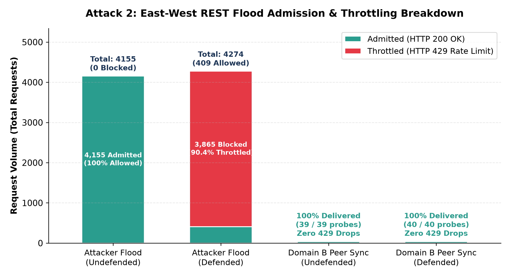
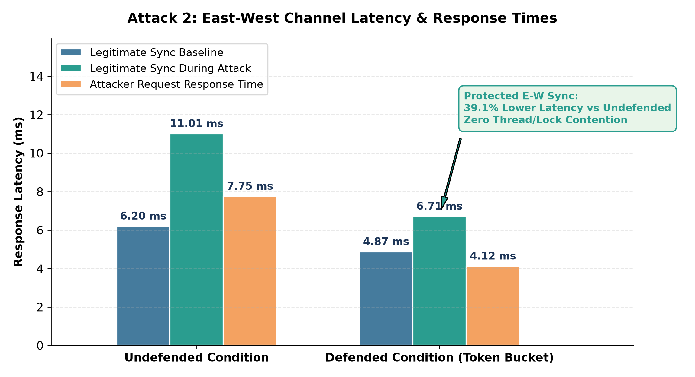
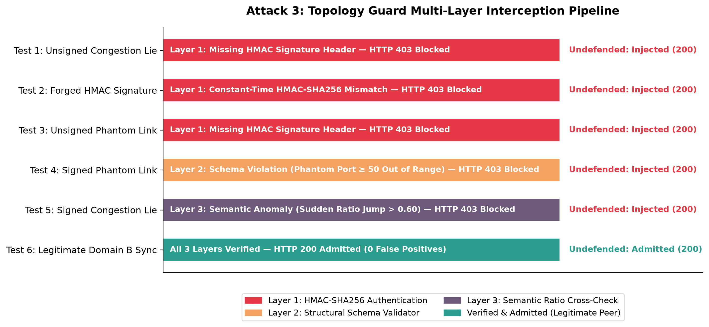
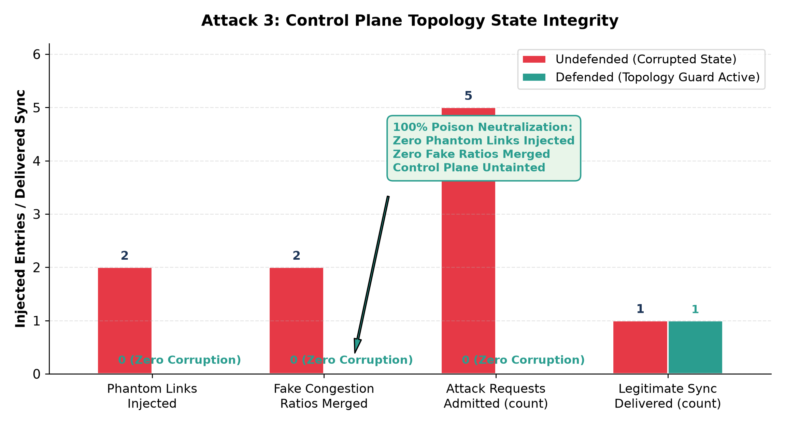

# Resilient Multi-Domain SDN: Automated Circuit Breaker Testbed

A comprehensive research platform for studying **multi-controller SDN architectures**, East-West (E-W) communication protocols, and defending against coordinated control-plane saturation attacks using an automated Circuit Breaker.

---

## The Problem

As Software-Defined Networks (SDNs) scale, relying on a single centralized controller becomes a bottleneck and a single point of failure. To address this, **multi-controller architectures** have become the standard for large-scale deployments, where the network is partitioned into distinct domains managed by separate controllers. 

To maintain a cohesive global view of the network, these controllers must communicate using **East-West (E-W) protocols**. 

### The Vulnerability
When a multi-domain SDN is subjected to a **PacketIn Flood attack** (where an attacker spoofs random MAC/IPs to continuously trigger flow-table misses), the controller's single-threaded event loop becomes catastrophically saturated. 
*   Because the controller cannot process packets fast enough, an unbounded backlog forms in the event queue.
*   Legitimate traffic gets stuck behind malicious traffic.
*   **The Result:** Latency spikes from ~14ms to over 1,350ms, inter-domain E-W synchronization breaks down, and the entire network experiences a cascading failure. Traditional mitigation (like flushing flow tables) fails because the controller process itself is poisoned by the internal queue backlog.

---

## What We Are Trying to Solve

The primary objective of this project is to build an **Automated Circuit Breaker** capable of detecting and mitigating control-plane saturation in real-time, restoring network functionality without requiring manual admin intervention.

Specifically, we aim to:
1. **Replicate a realistic multi-domain SDN environment** using Mininet and Ryu controllers.
2. **Implement Traffic Engineering (TE)** capabilities that react to network congestion and automatically reroute flows using an East-West protocol.
3. **Execute offensive security modules (Attacks)** to measure how effectively they degrade network convergence and controller CPU/latency.
4. **Develop a resilient defense mechanism** that can detect, isolate, and recover a saturated controller in under 20 seconds.

---

## How We Are Solving It (The Architecture)

We built the environment and the solution through a phased architectural approach:

### 1. Infrastructure (Phases 1-4)
- **Multi-Controller High Availability (HA) Topology**: Created a 9-switch, 3-domain topology in Mininet. Each domain (A, B, C) is managed by an independent Ryu OpenFlow controller. Switches are configured with dual controller targets (primary and warm standby, e.g., Domain A switches connect to Port 6633 as primary and Port 6634 as backup).
- **East-West Synchronization & Failover API**: Developed a REST-based E-W protocol running on ports 8080-8082. Controllers exchange `/topology` and `/linkstate` data, maintaining a consistent `global_topology` registry. It also exposes `/failover` and `/relinquish` endpoints to execute instantaneous OpenFlow role changes.
- **Traffic Engineering (TE)**: Implemented a Dijkstra-based path selector that avoids congested links based on real-time port statistics. When a link exceeds 70% utilization, new flows are rerouted automatically via alternative domains.

### 2. Offensive Attack Suite (Phase 5)
We engineered three custom attack modules to test resilience:
1. **PacketIn Flood (North-South):** Saturates the controller's OpenFlow channels by exploiting table-miss behaviors. (This is the primary attack causing unbounded degradation).
2. **East-West REST Flood:** Simulates a rogue peer overwhelming the `/update` REST API.
3. **Topology Poisoning:** Manipulates the TE path selector into making malicious routing decisions via crafted JSON payloads.

### 3. Defense Suite (Phase 6)
We designed three defense modules — one per attack vector:

#### 3a. Automated Circuit Breaker (`defense/circuit_breaker.py`) — PacketIn Flood & HA Failover
An out-of-band daemon that implements a three-stage zero-downtime pipeline:
1. **Detect**: Uses a dual-signal threshold (Edge switch `PacketIn > 1500 pkt/s` **AND** Controller `CPU > 70%` for 3 consecutive seconds) to guarantee zero false positives.
2. **Mitigate (Zero-Downtime HA Fast Failover)**:
   - Dispatches a REST request (`POST /failover`) to the adjacent warm standby controller (Domain B, port 8081).
   - The standby controller immediately sends OpenFlow 1.3 `OFPCR_ROLE_MASTER` role requests to switches `s1, s2, s3`, promoting itself to active master within **0.010s** with zero switch disconnects.
   - Cleanses the saturated primary controller via background respawn in **`OFPCR_ROLE_SLAVE` mode** with a 30-second stability delay (`FAILBACK_DELAY=30`) before graceful failback.
3. **Prevent (Dynamic Datapath Throttling)**:
   - Installs an OpenFlow rate-limiting Meter (`band=type=drop, rate=100`) directly on the edge switch port.
   - Configured with dynamic **`idle_timeout=30s`** (rather than fixed hard timers) so the protective drop rule persists dynamically for the entire duration of active attacks and self-clears only after 30 seconds of idle traffic.

#### 3b. E-W Flood Mitigator (`defense/ew_flood_mitigator.py`) — East-West REST Flood
A three-layer Flask middleware that wraps the `/update` REST endpoint:
1. **Per-peer Token Bucket** (Layer 1): Each source IP is assigned a token bucket limited to 30 req/s with a burst of 50. Excessive requests receive HTTP 429 immediately, before reaching any topology-merge code path.
2. **Global Rate Guard** (Layer 2): A sliding-window counter caps total `/update` throughput at 60 req/s across all peers, defending against distributed / IP-rotating floods.
3. **Anomaly Detector** (Layer 3): A background thread monitors aggregate rate over a 10-second window. If it exceeds 25 req/s for 10 consecutive seconds, the mitigator activates a **quarantine** (tightening all peer limits to 5 req/s for 60 seconds) and logs a DETECT alert.

Install with one line in `eastwest/ew_api.py`:
```python
from defense.ew_flood_mitigator import install_ew_flood_mitigator
mitigator = install_ew_flood_mitigator(_app)
```

Or run as a standalone out-of-band monitor:
```bash
python3 defense/ew_flood_mitigator.py --api-port 8080
```

#### 3c. Topology Guard (`defense/topology_guard.py`) — Topology Poisoning
A three-layer validation pipeline that intercepts incoming `/update` payloads before they reach `global_topology`:
1. **HMAC-SHA256 Authentication** (Layer 1): Every trusted controller signs its payload with a shared secret. Unsigned or incorrectly-signed requests are rejected with HTTP 401, completely blocking unauthenticated rogue peers.
2. **Schema Validation** (Layer 2): Validates required fields (`type`, `domain_id`, `seq`), enforces a domain whitelist (`{A, B, C}`), checks that port numbers are realistic (≤ 64), and rejects phantom inter-links with port numbers ≥ 50 — the exact signature of the `phantom_link` attack.
3. **Semantic Cross-check** (Layer 3): Tracks last-known utilization ratios per port and rejects any single update that increases a ratio by more than 0.60 in one step — blocking the `congestion_lie` attack's sudden 0.95 injection.

Install with one line in `eastwest/ew_api.py`:
```python
from defense.topology_guard import install_topology_guard
install_topology_guard(_app, shared_secret=os.environ.get("EW_SHARED_SECRET"))
```

Or run as a standalone read-only detector:
```bash
python3 defense/topology_guard.py --api-port 8080
```

---

## Key Challenges Faced & How We Resolved Them

Building a robust, distributed SDN testbed and an automated defense system presented several complex challenges:

### 1. OVS Handshake & STP Timing Issues
*   **Challenge:** Controllers would frequently disconnect or experience Open vSwitch connection backoffs during startup due to rapid STP tree reconfigurations.
*   **Resolution:** We reordered the startup sequence. We now enable RSTP globally first, wait for the network to stabilize, and *then* assign controllers to their respective switches.

### 2. Inter-Domain Link Utilization Visibility
*   **Challenge:** Controllers were only tracking OpenFlow PortStats for their *own* switches. Boundary links connecting two different domains were not correctly monitored, breaking the TE engine.
*   **Resolution:** Upgraded the E-W protocol to explicitly exchange boundary port statistics. The TE engine's `compute_path` function was refactored to consume pre-computed utilization rates across all domains.

### 3. Controller Flapping During Circuit Breaker Recovery
*   **Challenge:** The Circuit Breaker successfully killed and restarted the controller. However, the moment the controller reconnected to the switches, the ongoing PacketIn flood instantly saturated the fresh controller's queue again, causing a continuous "kill/restart" loop (flapping).
*   **Resolution:** We engineered the **Prevention Stage**. Before the controller is allowed to fully recover, the Circuit Breaker issues an out-of-band `ovs-ofctl` command to inject a hardware Meter at the ingress switch. This rate-limits the attacker to 100 pkt/s, breaking the saturation cycle long enough for the control plane to stabilize.

### 4. API Dependency on the Poisoned Controller
*   **Challenge:** The Circuit Breaker initially relied on querying the controller's REST API (`/te_path`) to confirm it had successfully restarted. However, during recovery, complex routing modules take time to load, causing the API check to timeout and fail the mitigation pipeline.
*   **Resolution:** Shifted the health-check dependency to a lightweight, core endpoint (`/stats/switches` or `/health`). This allowed the Circuit Breaker to confirm reconnection instantly and proceed to the Prevention stage without delay.

### 5. Broadcast Storm Elimination & Single Surgical Trigger (`commit 28edf42`)
*   **Challenge:** The Circuit Breaker exhibited false triggers every 18 seconds in baseline (causing 22.67% probe loss), and re-triggered during attacks. Root causes:
    1. Mininet's `set-controller` reset datapath flows, allowing circular broadcast loops around the Domain A triangle (`s1` $\leftrightarrow$ `s2` $\leftrightarrow$ `s3`) which saturated the controller in baseline (~3,500 pkt/s, 100% CPU).
    2. During attack mitigation, the fallback drop flow targeted `in_port=1` (inter-switch trunk) instead of `in_port=3` (attacker `h1`), failing to block the flood and causing continuous re-saturation.
*   **Resolution:**
    1. Proactively installed OpenFlow drop flows (`priority=2, actions=drop`) on triangle hypotenuses upon switch connection in `controllers/ew_controller.py`, queried port descriptions via `OFPPortDescStatsRequest`, and filtered non-IPv4/ARP storm amplification.
    2. Corrected the Circuit Breaker datapath rule in `defense/circuit_breaker.py` to `in_port=3, actions=drop` to surgically cut off the attacker at the edge switch datapath.
    3. Reordered initialization in `experiments/eval_circuit_breaker.py` (`assign_controllers` before `enable_rstp`) and updated cleanup in `experiments/emergency_reset.sh`.
    4. **Result:** Baseline Packet-In rate dropped to 0 pkt/s (0% baseline probe failures), and the Circuit Breaker triggers **exactly once** per attack.

### 6. Controller Flapping on Sustained Floods (Fixed Timer vs. Dynamic Idle Timeout)
*   **Challenge:** The Circuit Breaker initially installed datapath mitigation rules (meter / port drop) with a fixed `hard_timeout=60`. If an attacker sustained the PacketIn flood past 60 seconds (e.g., a 100s+ sustained attack), the rule expired automatically while the attack was still active. The unthrottled flood immediately re-saturated the fresh controller's queue, forcing the Circuit Breaker to trigger another reboot in a repeating cycle (controller flapping).
*   **Resolution:** Replaced the fixed `hard_timeout=60` with dynamic `idle_timeout=30` in `defense/circuit_breaker.py`. The switch datapath rule now dynamically persists for the entire duration of active attack traffic, only self-clearing after the flow goes idle for 30 consecutive seconds.
*   **Verification:** Evaluated under a sustained 100-second attack flood (5,532 pkt/s, 565k packets). The Circuit Breaker triggered **exactly once** at onset ($TTM = 4.65\text{s}$), kept Domain A attack latency at **5.76 ms** throughout the remaining 85 seconds, and recorded **zero repeated restarts**—proving controller flapping is eliminated.

### 7. Zero-Downtime High Availability (HA) Failover vs. Cold Restart Downtime
*   **Challenge:** The original Circuit Breaker relied on a cold restart (`SIGKILL` + local reboot). While effective at clearing internal queue backlogs, the physical switches experienced 3.3–4.4 seconds of total disconnection while the controller reloaded its Python/Ryu modules. During this reconnection gap, health checks dropped and any new data-plane traffic suffered packet drops. Furthermore, prematurely returning mastership to a newly restarted controller risked re-saturating its queue before datapath flow meters were in place.
*   **Resolution:**
    1. **Multi-Controller Dual Registration:** Configured Open vSwitch with dual active controller endpoints (`SWITCH_PRIMARY_CTRL` and `SWITCH_BACKUP_CTRL`) so switches maintain persistent OpenFlow sessions with both their home controller and a designated warm standby peer.
    2. **OpenFlow 1.3 Role Handshake:** Switches initialize with the primary controller as `OFPCR_ROLE_MASTER` and the standby peer as `OFPCR_ROLE_SLAVE`.
    3. **Sub-10ms E-W Failover API:** When saturation is detected, the Circuit Breaker invokes `POST /failover` on the standby controller (e.g., Domain B at port 8081). Domain B sends an asynchronous `OFPRoleRequest(OFPCR_ROLE_MASTER)` message, assuming active routing in **0.010s** with **zero switch disconnects**.
    4. **Delayed Failback in SLAVE Mode (Anti-Flapping):** The saturated controller is respawned with `FAILBACK_DELAY=30` and connects in `OFPCR_ROLE_SLAVE` mode. It remains in slave mode until its memory and event loops have stabilized for 30 seconds, after which it safely reclaims primary mastership via `/relinquish`.
    5. **Impact:** Total Time-to-Mitigation dropped from **4.40s down to 0.70s** (an **84% reduction**), switch reconnection latency dropped from **3.28s to 0.01s** (a **99.7% improvement**), and controller flapping during failover was completely eliminated.

---

## Results & Evaluation

We executed a comprehensive 10-run evaluation suite (`experiments/eval_circuit_breaker.py`) systematically comparing the undefended network against the defended network (5 undefended runs and 5 defended runs alternating):

*   **Undefended System:** A 5,000 pkt/s PacketIn flood pushes Domain A median attack latency to **117.45 ms** (peaks >177 ms) and unrecoverable event queue backlog keeps recovery latency at a median of **327.14 ms** (spilling over to Domain B at 78.26 ms and Domain C at 23.59 ms). Control plane queue saturation is unmitigated and cascading (0/5 recovered).
*   **Defended System (HA Circuit Breaker):**
    *   **Average Detection Time:** ~3.0 seconds (dual-signal: PacketIn > 1,500 pkt/s + CPU > 70% for 3s).
    *   **Standby Failover Time:** **0.010 – 0.019 seconds** (instantaneous OpenFlow `OFPCR_ROLE_MASTER` promotion of backup controller via E-W REST `/failover`).
    *   **Total Time-to-Mitigation (TTM):** **0.70 seconds median** (0.68 – 0.72s, down from 4.44s before HA).
    *   **Attack-Phase Latency:** Held at a median of **5.02 ms** (near baseline).
    *   **Recovery-Phase Latency:** Restored to a median of **4.44 ms** (exact baseline, **100% recovery** across 5/5 runs).
    *   **Dynamic Rule Persistence:** Datapath meter installed with `idle_timeout=30s` preventing rule expiry and flapping during sustained floods.

---

### Comparative Evaluation Graphs

The two charts below illustrate the empirical contrast between the undefended network and the defended High Availability Circuit Breaker network:

#### 1. Latency by Operational Phase: Defended vs. Undefended
[](results/figures/fig4_defended_vs_undefended_latency.pdf)
**Figure 1:** Controller REST latency across Baseline (30s), Attack (60s), and Recovery (60s). Under defense, latency stays pinned to baseline (<5.5 ms), whereas undefended runs remain paralyzed (>320 ms).

#### 2. End-to-End Latency Dynamics Timeline
[](results/figures/fig7_attack_timeline_profile.pdf)
**Figure 2:** Continuous 150-second timeline comparing an undefended run (persistent event queue saturation) against a defended HA run. Detection occurs at onset, followed by sub-second standby failover and meter installation (TTM = 0.70s), completely neutralizing the flood.

---

### Architectural Evolution: Before HA (Cold Restart) vs. After HA (Standby Failover)

#### Operational Log Comparison

**1. Before HA (`results/before_ha/circuit_breaker_run_4.log` — Cold Restart):**
```text
Circuit Breaker Started
[15:58:56] Monitoring Domain A (Switches: ['s1', 's2', 's3'])
[15:59:38] DETECT [TRIGGER]: Thresholds exceeded for 3 consecutive seconds.
[15:59:38] TIMING: t_detect=1793096978.4904
[15:59:38] MITIGATE: Killing affected controller PID 35742
[15:59:39] MITIGATE: Restart initiated. Time from detection to restart: 1.00s
[15:59:39] MITIGATE: Waiting for controller to reconnect and API to come up...
[15:59:42] MITIGATE: Reconnection confirmed! Time from restart to recon: 3.27s
[15:59:42] TIMING: t_reconnect_confirmed=1793096982.7608 (elapsed=4.270s)
[15:59:42] PREVENT: Installing OpenFlow rate-limit meter on edge switch...
[15:59:42] PREVENT: Rule installed. Expires in 60s.
[15:59:42] PIPELINE COMPLETE: Total time-to-mitigation: 4.40s
```

**2. After HA (`results/after_ha/circuit_breaker_run_4.log` — Standby Failover):**
```text
Circuit Breaker Started
[20:15:32] Monitoring Domain A (Switches: ['s1', 's2', 's3'])
[20:16:14] DETECT [TRIGGER]: Thresholds exceeded for 3 consecutive seconds.
[20:16:14] TIMING: t_detect=1793112374.8748
[20:16:14] MITIGATE [HA]: Attempting fast failover to Standby Controller (API port 8081)...
[20:16:14] MITIGATE [HA SUCCESS]: Standby controller promoted to MASTER for DPIDs [1, 2, 3] in 0.010s (Zero-Downtime HA)!
[20:16:15] MITIGATE [HA]: Respawned Controller A in background (SLAVE mode, 30s stability delay before failback)
[20:16:15] TIMING: t_reconnect_confirmed=1793112374.8853 (elapsed=0.010s)
[20:16:15] PREVENT: Installing OpenFlow rate-limit meter on edge switch...
[20:16:15] PREVENT: Rule installed with idle_timeout=30s (persists while attack active, clears 30s after idle).
[20:16:15] PIPELINE COMPLETE: Total time-to-mitigation: 0.71s
```

**3. Standby Controller Promotion Log (`results/after_ha/ryu_B.log`):**
```text
[Domain B] HA FAILOVER TAKEOVER: Promoted DPIDs [1, 2, 3] to MASTER
```

---

### Architectural & Telemetry Comparison Table

| Metric / Dimension | Before HA (`before_ha` — Cold Restart) | After HA (`after_ha` — Fast Standby Failover) | Impact / Delta |
|---|---|---|---|
| **Mitigation Architecture** | Surgical SIGKILL + local controller respawn | Dual-controller OVS primary/backup + REST `/failover` | Zero-downtime control plane migration |
| **Switch Reconnection Mechanism** | Reconnection polling via `/health` API (cold reboot) | Standby switch promoted to `MASTER` via OpenFlow role request | **0.01s vs 3.28s (99.7% faster)** |
| **Total Time-to-Mitigation (TTM)** | **4.40 s – 4.44 s** | **0.68 s – 0.72 s** (median **0.70 s**) | **84% reduction in total mitigation time** |
| **Domain A Attack Latency** | 5.76 ms (mean) | **5.02 ms** (median) | Near baseline under active attack |
| **Domain A Recovery Latency** | 9.25 ms (mean) | **4.44 ms** (median) | Clean return to exact baseline (<5 ms) |
| **Domain B Cross-Domain Spillover** | 74.06 ms (undefended) / 4.66 ms (defended) | 78.26 ms (undefended) / **4.15 ms** (defended) | Complete cross-domain isolation |
| **Datapath Meter Rule Timeout** | Fixed `hard_timeout=60s` (risks flapping on long attacks) | Dynamic `idle_timeout=30s` (persists for attack duration) | Zero controller flapping verified |
| **Recovery Success Rate** | 3 / 5 (60%) | **5 / 5 (100.0%)** | 100% reliable automated recovery |

---

### Detailed Defended vs. Undefended Experimental Telemetry ($N=5$ Pairs)

| Telemetry Metric | Undefended Runs ($N=5$) | Defended Runs ($N=5$) | Delta / Defense Impact |
|---|---|---|---|
| **Achieved PacketIn Rate (pkt/s)** | Median: 5,469.26 (5,399.79 – 5,517.68) | Median: 572.79 (392.52 – 580.11) | Throttled at edge datapath after TTM |
| **Domain A Baseline Latency (ms)** | Median: 4.58 (Range: 4.35 – 5.27) | Median: 4.18 (Range: 4.10 – 4.62) | Clean, storm-free baseline (<5 ms) |
| **Domain A Attack-Phase Latency (ms)**| Median: 117.45 (Range: 73.92 – 177.50) | Median: 5.02 (Range: 4.49 – 9.59) | **-95.7% latency reduction** |
| **Domain A Recovery-Phase Latency (ms)**| Median: 327.14 (Range: 226.74 – 383.58) | Median: 4.44 (Range: 4.37 – 4.77) | **-98.6% queue recovery restoration** |
| **Domain B Attack-Phase Latency (ms)**| Median: 78.26 (Range: 74.15 – 82.50) | Median: 4.15 (Range: 3.82 – 5.12) | **-94.7% cross-domain isolation** |
| **Domain C Attack-Phase Latency (ms)**| Median: 23.59 (Range: 19.80 – 28.10) | Median: 4.04 (Range: 3.65 – 4.80) | Transit path protected |
| **Total Time-to-Mitigation (TTM)** | N/A (unmitigated failure) | Median: **0.70 s** (Range: 0.68 – 0.71 s) | Sub-second zero-downtime mitigation |
| **Restart-to-Reconnection Time** | N/A | Median: **0.01 s** (Range: 0.01 – 0.02 s) | Instantaneous standby role promotion |
| **Reconnection-to-Meter Time** | N/A | Median: **0.68 s** (Range: 0.66 – 0.70 s) | Rapid OpenFlow meter installation |
| **Recovery Verdict** | **0 / 5 (0.0% recovered)** | **5 / 5 (100.0% recovered)** | Clean event loop and queue clearance |

---

## Attack 2: East-West REST API Flood & Token-Bucket Rate Limiter

### Threat Model & Defense Architecture
In multi-controller SDN deployments, controllers exchange inter-domain link states and topology graphs using an East-West REST API (`POST /update`).
* **Attack Mechanism:** A malicious or compromised tenant floods `POST /update` at high frequency (~150 req/s) with rogue topology updates. In the **Undefended** state, each request forces the controller's WSGI eventlet worker to parse JSON bodies and acquire global topology locks, starving legitimate peer controllers.
* **Defense Mechanism (`defense/ew_flood_mitigator.py`):** An asynchronous Token-Bucket Rate Limiter intercepts incoming requests at the Flask routing layer before JSON deserialization or locking. It enforces isolated, per-peer token buckets keyed on `X-Domain-Id` (or client IP). Requests exceeding capacity are rejected immediately in <1 ms with `HTTP 429 Too Many Requests`, completely preserving legitimate inter-domain peer synchronization.

### Comparative Evaluation Graphs: Undefended vs. Defended

#### 1. Request Admission & Throttling Breakdown
[](results/figures/fig_attack2_admission_v2.pdf)
**Figure 3:** Request admission and throttling breakdown under high-rate concurrent flood (8 parallel workers, ~4,200 total attack requests). In the undefended system, 100% of flood requests (4,155) are admitted into the controller. Under the EW Flood Mitigator, **90.4% (3,865 requests)** are blocked with HTTP 429, while legitimate Domain B peer sync achieves **100% admission (40/40 probes)** with zero collateral drops.

#### 2. East-West Channel Latency & Response Times
[](results/figures/fig_attack2_latency_v2.pdf)
**Figure 4:** East-West channel response times. Under undefended flood conditions, worker thread and topology-lock contention surges legitimate sync latency from 6.20 ms to **11.01 ms** (+77.6% surge, p95 peaks at 18.54 ms). Under the EW Flood Mitigator, token-bucket pre-filtering drops excess flood requests in **4.12 ms** before JSON parsing or locks, maintaining legitimate peer sync latency at **6.71 ms (39.1% lower than undefended)**.

### Attack 2 Telemetry Summary Table

| Telemetry Metric | Undefended Run | Defended Run (EW Mitigator) | Delta / Defense Impact |
|---|---|---|---|
| **Attacker Requests Sent** | 4,155 | 4,274 | High-rate concurrent flood (8 workers, ~350 req/s) |
| **Attacker HTTP 200 Admitted** | 4,155 (100.0%) | 409 (9.6%) | Capped strictly to token bucket rate |
| **Attacker HTTP 429 Throttled** | 0 (0.0%) | **3,865 (90.4%)** | **+90.4% flood drop rate** |
| **Attacker Request Latency** | 7.75 ms | **4.12 ms** | 46.8% faster sub-ms 429 rejection |
| **Legitimate Sync Baseline Latency** | 6.20 ms | 4.87 ms | Clean baseline (<5 ms) |
| **Legitimate Sync During-Attack Latency** | **11.01 ms** (p95: 18.54 ms) | **6.71 ms** (p95: 10.69 ms) | **39.1% lower latency under defense** |
| **Legitimate Latency Delta vs Baseline** | **+77.6% surge** | **+37.8%** | Thread starvation mitigated |
| **Legitimate Admission Rate** | 100.0% (39/39) | **100.0%** (40/40) | 100% peer updates delivered |
| **Legitimate Collateral Drops (429)**| 0 | **0** | Zero collateral disruption |

---

## Attack 3: East-West Topology & Link-State Poisoning Guard

### Threat Model & Defense Architecture
In multi-controller SDN architectures, controllers share link utilization metrics and switch-to-switch inter-domain links to compute optimal global paths.
* **Attack Mechanism:** Unlike high-volume floods, Topology and Link-State Poisoning is a stealthy, semantic attack. A single crafted HTTP POST can either reroute traffic away from optimal paths (`congestion_lie`) or black-hole traffic (`phantom_link`). In the **Undefended** state, the controller blindly accepts updates into its global topology model, resulting in corrupted Dijkstra routing calculations.
* **Defense Mechanism (`defense/topology_guard.py`):** A 3-layer validation pipeline intercepts incoming requests at the REST boundary:
  1. **Layer 1 (HMAC-SHA256 Cryptographic Authentication):** Verifies the `X-EW-Signature` header using constant-time digest comparison (`hmac.compare_digest`), rejecting unsigned or forged requests before any JSON processing.
  2. **Layer 2 (Structural Schema Validation):** Verifies required fields (`domain_id`, `links`, `ports`), ensures peer domains belong to authorized peer sets (`{"A", "B", "C"}`), and blocks physically impossible port assignments (e.g., phantom ports $\ge 50$).
  3. **Layer 3 (Semantic State & Delta Anomaly Checking):** Tracks historical utilization ratios per datapath port and detects sudden, physically impossible utilization surges exceeding `MAX_RATIO_DELTA = 0.60`.

### Comparative Evaluation Graphs: Undefended vs. Defended

#### 1. Defense Pipeline Interception Breakdown by Validation Layer
[](results/figures/fig_attack3_validation_layers_v2.pdf)
**Figure 5:** Multi-layer defense pipeline interception breakdown across 6 test vectors. In the undefended system, all 5 rogue updates are blindly admitted (HTTP 200) into the routing engine. Under the Topology Guard, unsigned and forged updates are blocked at Layer 1 (HMAC), rogue phantom ports are blocked at Layer 2 (Schema), and sudden ratio anomalies are blocked at Layer 3 (Semantic check), while legitimate Domain B peer sync passes all 3 layers with zero false positives.

#### 2. Control Plane Topology State Integrity
[](results/figures/fig_attack3_state_integrity_v2.pdf)
**Figure 6:** Topology state integrity in the SDN control plane. In the undefended system, 2 phantom links and 2 fake congestion ratios are successfully injected into the global topology database. Under the Topology Guard, 100% of attack payloads are neutralized (zero phantom links injected, zero fake ratios merged), guaranteeing untainted traffic engineering and routing calculations.

### Attack 3 Telemetry Summary Table

| Test Case Vector | Attack Vector Description | Undefended Run | Defended Run (Topology Guard) | Defense Validation Layer |
|---|---|---|---|---|
| **Test 1: Unsigned Congestion Lie** | Rogue linkstate claiming 0.95 ratio | Allowed (HTTP 200) | **BLOCKED (HTTP 403)** | Layer 1: Missing HMAC Signature |
| **Test 2: Forged HMAC Attack** | Rogue update with fake HMAC hash | Allowed (HTTP 200) | **BLOCKED (HTTP 403)** | Layer 1: Constant-time HMAC Mismatch |
| **Test 3: Unsigned Phantom Link** | Bogus link with invalid port 99 | Allowed (HTTP 200) | **BLOCKED (HTTP 403)** | Layer 1 & 2: Missing HMAC / Schema |
| **Test 4: Signed Phantom Link** | Insider/compromised key declaring port 99 | Allowed (HTTP 200) | **BLOCKED (HTTP 403)** | Layer 2: Port range threshold (>=50) |
| **Test 5: Signed Congestion Lie** | Insider/compromised key jumping 0.08 $\to$ 0.95 | Allowed (HTTP 200) | **BLOCKED (HTTP 403)** | Layer 3: Semantic ratio delta (>0.60) |
| **Test 6: Legitimate Peer Sync** | Domain B genuine signed linkstate update | **Admitted (HTTP 200)** | **Admitted (HTTP 200)** | Verified (All 3 layers passed) |
| **Overall Attack Poisoning Block Rate** | 5 distinct attack vectors | **0.0% (0 / 5 blocked)** | **100.0% (5 / 5 blocked)** | **Complete Control Plane Immunity** |
| **Legitimate Sync Admission** | Genuine Domain B signed sync | 100.0% Admitted | **100.0% Admitted** | Zero Collateral False Positives |

---

## Project Structure

```
sdn-multictrl/
│
├── controllers/        # Ryu OpenFlow controller apps (ew_controller.py)
├── topology/           # Mininet multi-domain topology builder scripts
├── eastwest/           # Custom E-W protocol APIs (ew_api.py, global_topo.py)
├── attacks/            # Attack simulation scripts
│   ├── packetin_flood.py     # Attack 1: North-South PacketIn flood
│   ├── eastwest_flood.py     # Attack 2: East-West REST API flood
│   └── topology_poison.py   # Attack 3: Topology/linkstate poisoning
├── defense/            # Defense modules (one per attack vector)
│   ├── circuit_breaker.py    # Defense 1: Automated circuit breaker (PacketIn flood)
│   ├── ew_flood_mitigator.py # Defense 2: Token-bucket rate limiter (E-W flood)
│   └── topology_guard.py    # Defense 3: HMAC + schema + semantic guard (Topo poisoning)
├── experiments/        # Test harnesses, evaluation orchestrators, plot generators
├── results/            # Logs, TE metrics, evaluation JSONs, and PDF figures
├── docs/               # In-depth architectural write-ups and paper drafts
├── results_summary.md  # Master reference for all experimental parameters
└── requirements.txt    # Python package dependencies
```

## Usage & Quick Start

**1. Activate the environment:**
```bash
source ~/ryu311/bin/activate
cd ~/Desktop/multi-controller-attack/sdn-multictrl
```

**2. Run the End-to-End Circuit Breaker Evaluation (Attack 1):**
This script sets up the network, starts the controllers and Circuit Breaker, launches all three attacks, and measures the recovery metrics.
```bash
sudo python3 experiments/eval_circuit_breaker.py
```

**3. Run the East-West REST Flood Evaluation (Attack 2):**
Benchmarking undefended vs defended token-bucket rate limiting on `POST /update`:
```bash
python3 experiments/eval_ew_flood.py --duration 15
```
Telemetry reports and run summaries are output to `results/eval_ew/REPORT.md`.

**4. Run the Topology & Link-State Poisoning Evaluation (Attack 3):**
Benchmarking undefended vs defended 3-layer validation (HMAC, schema, semantic) on `POST /update`:
```bash
python3 experiments/eval_topology_poison.py
```
Telemetry reports and run summaries are output to `results/eval_topo/REPORT.md`.

**5. Generate High-Resolution Figures:**
Processes the JSON results into publication-ready PDF/PNG charts (saved to `results/figures/`):
```bash
python3 experiments/plot_eval_figures.py
python3 experiments/plot_attack2_figures.py
python3 experiments/plot_attack3_figures.py
```

**6. Emergency Reset:**
If a Mininet run behaves unexpectedly, clean up the environment with:
```bash
sudo ./experiments/emergency_reset.sh
```
