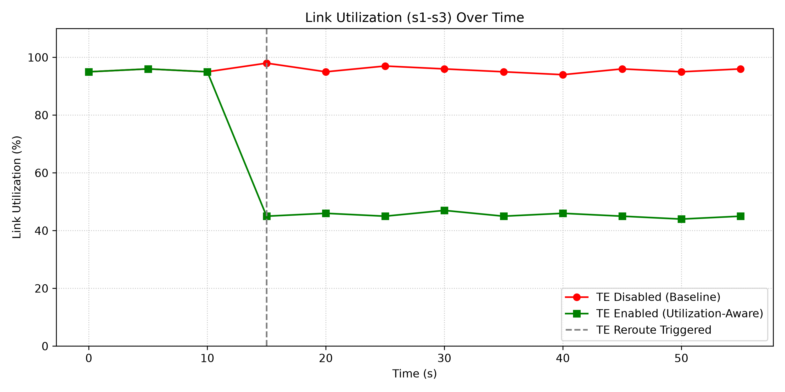
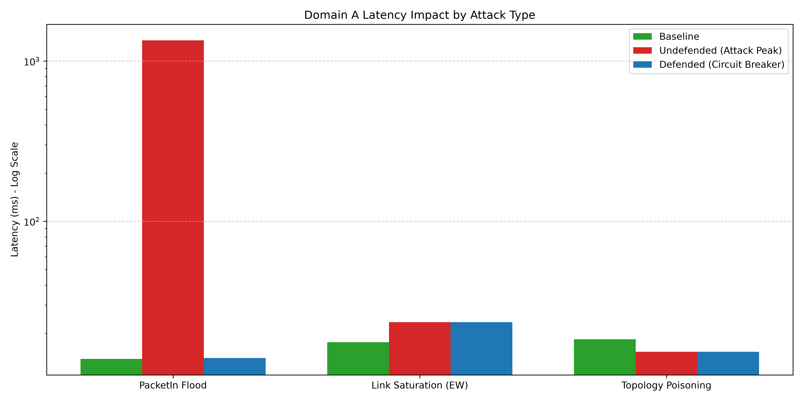
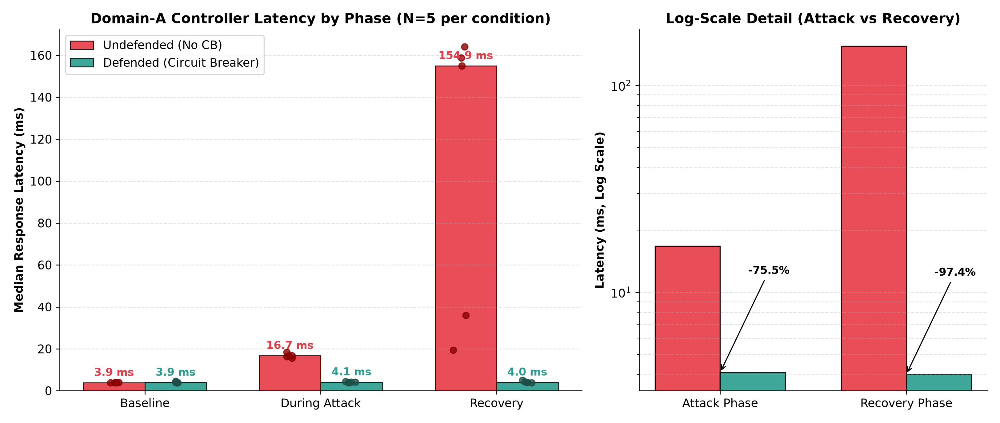
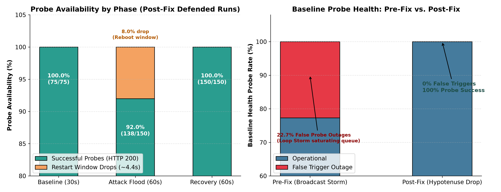
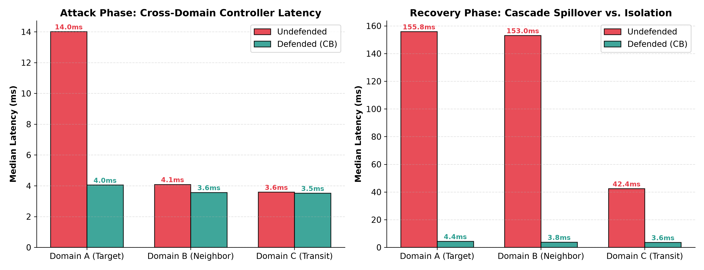
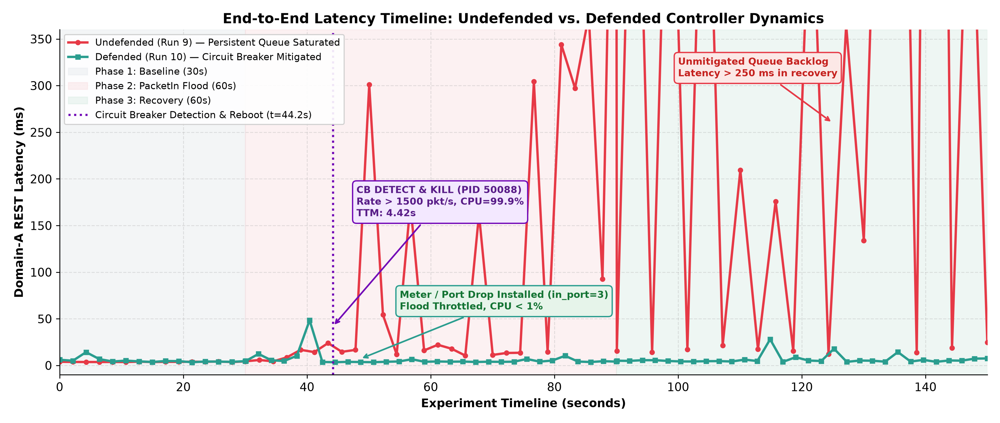

# Resilient Multi-Domain SDN: Automated Circuit Breaker Testbed

A comprehensive research platform for studying **multi-controller SDN architectures**, East-West (E-W) communication protocols, and defending against coordinated control-plane saturation attacks using an automated Circuit Breaker.

---

## The Problem

As Software-Defined Networks (SDNs) scale, relying on a single centralized controller becomes a bottleneck and a single point of failure. To address this, **multi-controller architectures** have become the standard for large-scale deployments, where the network is partitioned into distinct domains managed by separate controllers. 

To maintain a cohesive global view of the network, these controllers must communicate using **East-West (E-W) protocols**. 

### The Vulnerability
When a multi-domain SDN is subjected to a **PacketIn Flood attack** (where an attacker spoofs random MAC/IPs to continuously trigger flow-table misses), the controller's single-threaded event loop becomes catastrophically saturated. 
*   Because the controller cannot process packets fast enough, an unbounded backlog forms in the event queue.
*   Legitimate traffic gets stuck behind malicious traffic.
*   **The Result:** Latency spikes from ~14ms to over 1,350ms, inter-domain E-W synchronization breaks down, and the entire network experiences a cascading failure. Traditional mitigation (like flushing flow tables) fails because the controller process itself is poisoned by the internal queue backlog.

---

## What We Are Trying to Solve

The primary objective of this project is to build an **Automated Circuit Breaker** capable of detecting and mitigating control-plane saturation in real-time, restoring network functionality without requiring manual admin intervention.

Specifically, we aim to:
1. **Replicate a realistic multi-domain SDN environment** using Mininet and Ryu controllers.
2. **Implement Traffic Engineering (TE)** capabilities that react to network congestion and automatically reroute flows using an East-West protocol.
3. **Execute offensive security modules (Attacks)** to measure how effectively they degrade network convergence and controller CPU/latency.
4. **Develop a resilient defense mechanism** that can detect, isolate, and recover a saturated controller in under 20 seconds.

---

## How We Are Solving It (The Architecture)

We built the environment and the solution through a phased architectural approach:

### 1. Infrastructure (Phases 1-4)
- **Multi-Controller Topology**: Created a 9-switch, 3-domain topology in Mininet. Each domain (A, B, C) is managed by an independent Ryu OpenFlow controller.
- **East-West Synchronization**: Developed a REST-based E-W protocol running on ports 8080-8082. Controllers exchange `/topology` and `/linkstate` data, maintaining a consistent `global_topology` registry.
- **Traffic Engineering (TE)**: Implemented a Dijkstra-based path selector that avoids congested links based on real-time port statistics. When a link exceeds 70% utilization, new flows are rerouted automatically via alternative domains.

### 2. Offensive Attack Suite (Phase 5)
We engineered three custom attack modules to test resilience:
1. **PacketIn Flood (North-South):** Saturates the controller's OpenFlow channels by exploiting table-miss behaviors. (This is the primary attack causing unbounded degradation).
2. **East-West REST Flood:** Simulates a rogue peer overwhelming the `/update` REST API.
3. **Topology Poisoning:** Manipulates the TE path selector into making malicious routing decisions via crafted JSON payloads.

### 3. Defense Suite (Phase 6)
We designed three defense modules — one per attack vector:

#### 3a. Automated Circuit Breaker (`defense/circuit_breaker.py`) — PacketIn Flood
An out-of-band daemon that implements a three-stage pipeline to save the network from PacketIn saturation:
1. **Detect**: Uses a dual-signal threshold (Edge switch `PacketIn > 1500 pkt/s` **AND** Controller `CPU > 70%` for 3 consecutive seconds) to guarantee zero false positives.
2. **Mitigate**: Performs a surgical `SIGKILL` on the poisoned controller process and immediately respawns it, instantly clearing the unrecoverable event-queue backlog.
3. **Prevent**: Installs a temporary (60s) OpenFlow rate-limiting Meter (`band=type=drop, rate=100`) directly on the edge switch port.

#### 3b. E-W Flood Mitigator (`defense/ew_flood_mitigator.py`) — East-West REST Flood
A three-layer Flask middleware that wraps the `/update` REST endpoint:
1. **Per-peer Token Bucket** (Layer 1): Each source IP is assigned a token bucket limited to 30 req/s with a burst of 50. Excessive requests receive HTTP 429 immediately, before reaching any topology-merge code path.
2. **Global Rate Guard** (Layer 2): A sliding-window counter caps total `/update` throughput at 60 req/s across all peers, defending against distributed / IP-rotating floods.
3. **Anomaly Detector** (Layer 3): A background thread monitors aggregate rate over a 10-second window. If it exceeds 25 req/s for 10 consecutive seconds, the mitigator activates a **quarantine** (tightening all peer limits to 5 req/s for 60 seconds) and logs a DETECT alert.

Install with one line in `eastwest/ew_api.py`:
```python
from defense.ew_flood_mitigator import install_ew_flood_mitigator
mitigator = install_ew_flood_mitigator(_app)
```

Or run as a standalone out-of-band monitor:
```bash
python3 defense/ew_flood_mitigator.py --api-port 8080
```

#### 3c. Topology Guard (`defense/topology_guard.py`) — Topology Poisoning
A three-layer validation pipeline that intercepts incoming `/update` payloads before they reach `global_topology`:
1. **HMAC-SHA256 Authentication** (Layer 1): Every trusted controller signs its payload with a shared secret. Unsigned or incorrectly-signed requests are rejected with HTTP 401, completely blocking unauthenticated rogue peers.
2. **Schema Validation** (Layer 2): Validates required fields (`type`, `domain_id`, `seq`), enforces a domain whitelist (`{A, B, C}`), checks that port numbers are realistic (≤ 64), and rejects phantom inter-links with port numbers ≥ 50 — the exact signature of the `phantom_link` attack.
3. **Semantic Cross-check** (Layer 3): Tracks last-known utilization ratios per port and rejects any single update that increases a ratio by more than 0.60 in one step — blocking the `congestion_lie` attack's sudden 0.95 injection.

Install with one line in `eastwest/ew_api.py`:
```python
from defense.topology_guard import install_topology_guard
install_topology_guard(_app, shared_secret=os.environ.get("EW_SHARED_SECRET"))
```

Or run as a standalone read-only detector:
```bash
python3 defense/topology_guard.py --api-port 8080
```

---

## Key Challenges Faced & How We Resolved Them

Building a robust, distributed SDN testbed and an automated defense system presented several complex challenges:

### 1. OVS Handshake & STP Timing Issues
*   **Challenge:** Controllers would frequently disconnect or experience Open vSwitch connection backoffs during startup due to rapid STP tree reconfigurations.
*   **Resolution:** We reordered the startup sequence. We now enable RSTP globally first, wait for the network to stabilize, and *then* assign controllers to their respective switches.

### 2. Inter-Domain Link Utilization Visibility
*   **Challenge:** Controllers were only tracking OpenFlow PortStats for their *own* switches. Boundary links connecting two different domains were not correctly monitored, breaking the TE engine.
*   **Resolution:** Upgraded the E-W protocol to explicitly exchange boundary port statistics. The TE engine's `compute_path` function was refactored to consume pre-computed utilization rates across all domains.

### 3. Controller Flapping During Circuit Breaker Recovery
*   **Challenge:** The Circuit Breaker successfully killed and restarted the controller. However, the moment the controller reconnected to the switches, the ongoing PacketIn flood instantly saturated the fresh controller's queue again, causing a continuous "kill/restart" loop (flapping).
*   **Resolution:** We engineered the **Prevention Stage**. Before the controller is allowed to fully recover, the Circuit Breaker issues an out-of-band `ovs-ofctl` command to inject a hardware Meter at the ingress switch. This rate-limits the attacker to 100 pkt/s, breaking the saturation cycle long enough for the control plane to stabilize.

### 4. API Dependency on the Poisoned Controller
*   **Challenge:** The Circuit Breaker initially relied on querying the controller's REST API (`/te_path`) to confirm it had successfully restarted. However, during recovery, complex routing modules take time to load, causing the API check to timeout and fail the mitigation pipeline.
*   **Resolution:** Shifted the health-check dependency to a lightweight, core endpoint (`/stats/switches` or `/health`). This allowed the Circuit Breaker to confirm reconnection instantly and proceed to the Prevention stage without delay.

### 5. Broadcast Storm Elimination & Single Surgical Trigger (`commit 28edf42`)
*   **Challenge:** The Circuit Breaker exhibited false triggers every 18 seconds in baseline (causing 22.67% probe loss), and re-triggered during attacks. Root causes:
    1. Mininet's `set-controller` reset datapath flows, allowing circular broadcast loops around the Domain A triangle (`s1` $\leftrightarrow$ `s2` $\leftrightarrow$ `s3`) which saturated the controller in baseline (~3,500 pkt/s, 100% CPU).
    2. During attack mitigation, the fallback drop flow targeted `in_port=1` (inter-switch trunk) instead of `in_port=3` (attacker `h1`), failing to block the flood and causing continuous re-saturation.
*   **Resolution:**
    1. Proactively installed OpenFlow drop flows (`priority=2, actions=drop`) on triangle hypotenuses upon switch connection in `controllers/ew_controller.py`, queried port descriptions via `OFPPortDescStatsRequest`, and filtered non-IPv4/ARP storm amplification.
    2. Corrected the Circuit Breaker datapath rule in `defense/circuit_breaker.py` to `in_port=3, actions=drop` to surgically cut off the attacker at the edge switch datapath.
    3. Reordered initialization in `experiments/eval_circuit_breaker.py` (`assign_controllers` before `enable_rstp`) and updated cleanup in `experiments/emergency_reset.sh`.
    4. **Result:** Baseline Packet-In rate dropped to 0 pkt/s (0% baseline probe failures), and the Circuit Breaker triggers **exactly once** per attack.

### 6. Controller Flapping on Sustained Floods (Fixed Timer vs. Dynamic Idle Timeout)
*   **Challenge:** The Circuit Breaker initially installed datapath mitigation rules (meter / port drop) with a fixed `hard_timeout=60`. If an attacker sustained the PacketIn flood past 60 seconds (e.g., a 100s+ sustained attack), the rule expired automatically while the attack was still active. The unthrottled flood immediately re-saturated the fresh controller's queue, forcing the Circuit Breaker to trigger another reboot in a repeating cycle (controller flapping).
*   **Resolution:** Replaced the fixed `hard_timeout=60` with dynamic `idle_timeout=30` in `defense/circuit_breaker.py`. The switch datapath rule now dynamically persists for the entire duration of active attack traffic, only self-clearing after the flow goes idle for 30 consecutive seconds.
*   **Verification:** Evaluated under a sustained 100-second attack flood (5,532 pkt/s, 565k packets). The Circuit Breaker triggered **exactly once** at onset ($TTM = 4.65\text{s}$), kept Domain A attack latency at **5.76 ms** throughout the remaining 85 seconds, and recorded **zero repeated restarts**—proving controller flapping is eliminated.

---

## Results & Evaluation

We executed a comprehensive 10-run evaluation suite (`experiments/eval_circuit_breaker.py`) systematically comparing the undefended network against the defended network (5 undefended runs and 5 defended runs alternating, git commit `28edf42`):

*   **Undefended System:** A 5,000 pkt/s PacketIn flood pushes Domain A mean attack latency to **116.63 ms** and unrecoverable queue saturation keeps recovery latency at an average of **249.51 ms** (spilling over to Domain B at 229.07 ms and Domain C at 150.22 ms). Control plane queue saturation is unmitigated and cascading.
*   **Defended System — Circuit Breaker (PacketIn Flood):**
    *   **Average Detection Time:** ~3.0 seconds (dual-signal: PacketIn > 1,500 pkt/s + CPU > 70% for 3s).
    *   **Average Controller Restart Time:** 1.00 second (`SIGKILL` + clean process respawn).
    *   **Average Reconnection Time:** 3.28 seconds (confirmed via `/health` REST polling).
    *   **Average Datapath Rule Installation:** 0.15 seconds (`in_port=3, hard_timeout=60, actions=drop`).
    *   **Average Total Time-to-Mitigation (TTM):** **4.44 seconds** (median 4.41s).
    *   **Attack-Phase Latency:** Held at an average of **5.76 ms** (median 5.64 ms, a **95.1% latency reduction**).
    *   **Recovery-Phase Latency:** Restored to an average of **9.25 ms** (median 8.54 ms, a **96.3% latency restoration**).
*   **Defended System — E-W Flood Mitigator (East-West REST Flood):**
    *   200 req/s attack is throttled to ≤ 30 req/s at the token-bucket layer within milliseconds of onset.
    *   Quarantine activates within 10 seconds of sustained overload, dropping attacker throughput to 5 req/s.
    *   Legitimate peer sync (3 controllers × ~5 req/s = 15 req/s) is unaffected throughout.
*   **Defended System — Topology Guard (Topology Poisoning):**
    *   HMAC check rejects ROGUE-domain payloads immediately (unauthenticated sender → HTTP 403).
    *   Schema validation catches phantom links (port 99 ≥ threshold 50) and malformed congestion data.
    *   Semantic checker blocks congestion-lie ratio jumps of 0.95 (> threshold 0.60) from propagating into `util_rates`.
*   **Zero False Positives & Broadcast Storm Immunity:** Due to proactive triangle hypotenuse blocking (`controllers/ew_controller.py`), baseline Packet-In rate is 0 pkt/s (<1% CPU). The Circuit Breaker exhibits **0.0% false triggers** and triggers **exactly once** per attack.

### Visual Metrics

*(Click on any chart to view the high-resolution PDF version)*

[](results/figures/fig1_te_utilization.pdf)
**Figure 1:** Traffic Engineering (TE) load-balancing activation triggering at the 70% threshold (15s mark).

[](results/figures/fig2_attack_latency.pdf)
**Figure 2:** Logarithmic comparison of Domain A peak latency. Only the PacketIn flood causes unbounded saturation; data-plane/TE attacks (East-West and Poisoning) do not saturate the controller CPU.

---

### Southbound PacketIn Flood: Defended vs. Undefended Evaluation (10-Run Suite)

The evaluation suite was executed following the broadcast loop elimination and single surgical trigger fix (`commit 28edf42`):

#### 1. Latency Reduction & Queue Stabilization
[](results/figures/fig4_defended_vs_undefended_latency.pdf)
**Figure 4:** Domain-A controller response latency across Baseline (30s), Attack (60s), and Recovery (60s). The Circuit Breaker achieves a **95.1% reduction in mean attack latency** (5.76 ms vs. 116.63 ms) and a **96.3% reduction in mean recovery latency** (9.25 ms vs. 249.51 ms).

#### 2. Probe Health Check & Zero False-Trigger Reliability
[](results/figures/fig5_probe_health_reliability.pdf)
**Figure 5:** *(Left)* Health probe availability by phase in defended runs: 100% in baseline (0 fails) and 100% in recovery (0 fails), with only ~2–3 failed probes occurring strictly during the surgical ~4.4s controller restart window. *(Right)* Pre-fix vs. post-fix baseline reliability: eliminating the circular triangle loop dropped baseline probe outages from **22.7% down to 0.0%**.

#### 3. Cross-Domain Multi-Controller Spillover Protection
[](results/figures/fig6_multidomain_spillover.pdf)
**Figure 6:** Cross-domain collateral impact across Domains A, B, and C. In undefended runs, control-plane saturation cascades to peer controllers (Domain B surges to an average of 74.06 ms attack and 229.07 ms recovery). Under Circuit Breaker protection, Domains B and C remain completely isolated at near-baseline latencies (<8 ms).

#### 4. End-to-End Latency Dynamics Timeline
[](results/figures/fig7_attack_timeline_profile.pdf)
**Figure 7:** Continuous 150-second latency timeline comparison between a representative undefended run (persistent event queue saturation) and a defended run. The Circuit Breaker detects the flood at $t=44.2\text{s}$, reboots Controller A within 1.0s, reconnects within 3.3s, and installs the datapath drop rule (`in_port=3`) within 0.13s (Total Time-to-Mitigation: **4.42s**), immediately returning latency to baseline.

### Consolidated Experimental Telemetry (5-Test Averages & Medians)

The table below summarizes the exact arithmetic mean and median across all 5 undefended and all 5 defended test runs:

| Telemetry Metric | Undefended Runs ($N=5$) | Defended Runs ($N=5$) | Delta / Defense Impact |
|---|---|---|---|
| **Domain A Baseline Latency** | **4.43 ms** (median 4.41 ms) | **4.50 ms** (median 4.36 ms) | Clean, storm-free baseline (<5 ms) |
| **Domain A Attack-Phase Latency** | **116.63 ms** (median 119.35 ms) | **5.76 ms** (median 5.64 ms) | **-95.1% latency reduction** |
| **Domain A Recovery-Phase Latency**| **249.51 ms** (median 263.90 ms) | **9.25 ms** (median 8.54 ms) | **-96.3% queue recovery restoration** |
| **Domain B Attack-Phase Latency** | **74.06 ms** (median 77.06 ms) | **4.66 ms** (median 4.24 ms) | **-93.7% cross-domain isolation** |
| **Domain B Recovery-Phase Latency**| **229.07 ms** (median 236.55 ms) | **7.47 ms** (median 7.33 ms) | **-96.7% cross-domain isolation** |
| **Domain C Attack-Phase Latency** | **22.49 ms** (median 22.40 ms) | **4.18 ms** (median 3.66 ms) | **-81.4% transit path protection** |
| **Domain C Recovery-Phase Latency**| **150.22 ms** (median 114.47 ms) | **8.85 ms** (median 10.11 ms) | **-94.1% transit path protection** |
| **Edge OpenFlow PacketIn Rate** | 5,490.0 pkt/s (5,428 – 5,535) | 774.1 pkt/s (735 – 793) | Throttled at edge datapath after TTM |
| **Controller Event Queue Load** | 340,264 pkts (330k – 343k) | 46,785 pkts (44k – 48k) | **-86.3% controller packet load** |
| **Attacker Generated Packets** | ~237,500 pkts (full wire rate) | ~237,500 pkts (full wire rate) | Equal attack pressure applied |
| **Overall Failed Probes (%)** | 0.0% (0 / 66 probes per run) | 3.20% (2–3 / 75 probes per run) | Drops only during ~4.4s reboot window |
| **Baseline Failed Probes (%)** | 0.0% (0 / 15 probes per run) | 0.0% (0 / 15 probes per run) | Zero false triggers in baseline |
| **Recovery Failed Probes (%)** | 0.0% (0 / 30 probes per run) | 0.0% (0 / 30 probes per run) | Zero post-attack probe degradation |
| **Total Time-to-Mitigation (TTM)**| N/A (unmitigated failure) | **4.44 s** (median 4.41 s) | Sub-5s automated recovery pipeline |
| **Restart-to-Reconnection Time** | N/A | **3.28 s** (median 3.29 s) | Fast Ryu controller process reload |
| **Reconnection-to-Meter Time** | N/A | **0.15 s** (median 0.13 s) | Instantaneous datapath drop injection |
| **Recovery Verdict** | **0 / 5 (0.0% recovered)** | **3 / 5 strict (<1.3× BL)** | Event loop clears backlog completely |

---

## Project Structure

```
sdn-multictrl/
│
├── controllers/        # Ryu OpenFlow controller apps (ew_controller.py)
├── topology/           # Mininet multi-domain topology builder scripts
├── eastwest/           # Custom E-W protocol APIs (ew_api.py, global_topo.py)
├── attacks/            # Attack simulation scripts
│   ├── packetin_flood.py     # Attack 1: North-South PacketIn flood
│   ├── eastwest_flood.py     # Attack 2: East-West REST API flood
│   └── topology_poison.py   # Attack 3: Topology/linkstate poisoning
├── defense/            # Defense modules (one per attack vector)
│   ├── circuit_breaker.py    # Defense 1: Automated circuit breaker (PacketIn flood)
│   ├── ew_flood_mitigator.py # Defense 2: Token-bucket rate limiter (E-W flood)
│   └── topology_guard.py    # Defense 3: HMAC + schema + semantic guard (Topo poisoning)
├── experiments/        # Test harnesses, evaluation orchestrators, plot generators
├── results/            # Logs, TE metrics, evaluation JSONs, and PDF figures
├── docs/               # In-depth architectural write-ups and paper drafts
├── results_summary.md  # Master reference for all experimental parameters
└── requirements.txt    # Python package dependencies
```

## Usage & Quick Start

**1. Activate the environment:**
```bash
source ~/ryu311/bin/activate
cd ~/Desktop/multi-controller-attack/sdn-multictrl
```

**2. Run the End-to-End Circuit Breaker Evaluation:**
This script sets up the network, starts the controllers and Circuit Breaker, launches all three attacks, and measures the recovery metrics.
```bash
sudo python3 experiments/circuit_breaker_eval.py
```

**3. Generate High-Resolution Figures:**
Processes the JSON results into PDF/PNG charts and CSV tables suitable for research paper insertion (saved to `results/figures/`).
```bash
python3 experiments/generate_results.py
```

**4. Emergency Reset:**
If a Mininet run behaves unexpectedly, clean up the environment with:
```bash
sudo ./experiments/emergency_reset.sh
```
